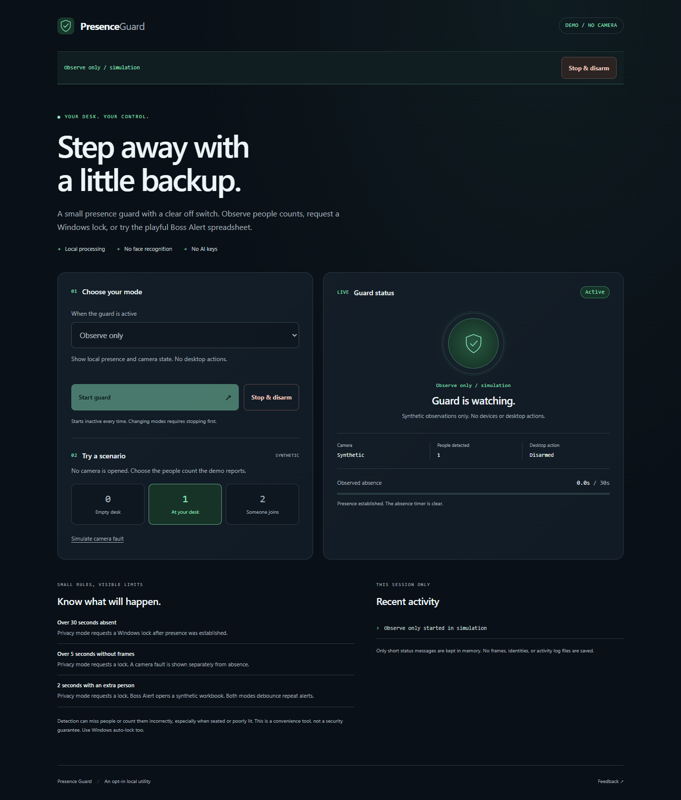

# Presence Guard

A local presence dashboard with three explicit modes: observe people counts, request a Windows lock, or open a playful **Boss Alert** spreadsheet when someone joins you. Start with the camera-free demo. No AI service, account, or API key is required.



| Mode | What happens while active |
| --- | --- |
| Observe only | Show people counts, absence time, and camera health. No desktop actions. |
| Privacy lock | Request a Windows lock after over 30 seconds of observed absence, over 5 seconds without fresh camera frames, or 2 continuous seconds with at least two people. |
| Boss Alert | After 2 continuous seconds with at least two people, open a workbook named `Boss Alert.xlsx` containing clearly marked synthetic data. This mode does not lock Windows. |

The absence rule starts only after at least one person has been detected. Returning resets the timer. Extra-person actions rearm after at least 5 continuous seconds with fewer than two people. Camera failure is shown as an unknown count, never as a claim that you left.

## Try it

1. Install [Python 3.11 or newer](https://www.python.org/downloads/). On Windows, enable **Add python.exe to PATH** in the official installer.
2. Download and extract this repository's source ZIP, or clone it. Open the extracted project folder.
3. On Windows, double-click **Start-Presence-Guard.cmd**. It opens the local demo in your browser and installs nothing.
4. Choose a mode and press **Start guard**. Try the synthetic 0, 1, and 2 person buttons, then **Stop & disarm**.

On Linux, macOS, or from a terminal in the project folder:

```text
python -m presence_guard --demo --open
```

Use `python3` if that is your Python 3 command. The demo uses only the Python standard library and starts inactive every time. Close the terminal or press Ctrl+C to exit. Closing the browser tab does not stop a running guard. The default address is `http://127.0.0.1:8790`; `--port 0` selects an available port.

## Use a local camera

On Windows, double-click **Install-Camera.cmd** and type `yes`. This creates a project-local `.venv`, downloads `opencv-contrib-python==4.13.0.92` and its compatible dependencies from the official PyPI index, and runs `pip check`. Only wheels are accepted. The OpenCV version is pinned; transitive dependencies are resolved by pip. No global install or administrator rights are needed. The installer does not open the camera.

In Command Prompt, open the project folder and run one of these commands:

```text
.venv\Scripts\python.exe -m presence_guard --camera --open
.venv\Scripts\python.exe -m presence_guard --camera --allow-lock --open
.venv\Scripts\python.exe -m presence_guard --camera --allow-spreadsheet --open
```

The first permits observation only. The other commands permit the corresponding mode in the dropdown; **Start guard** separately arms the selected action for that session. Camera capture begins only after Start. Stop disarms the session and requests camera release; the interface shows **Closing** until release finishes. Use `--camera-index 1` for a second camera. Both permissions may be supplied at launch, but only one action mode can be active.

Portable manual camera setup:

```text
python -m venv .venv
.venv/bin/python -m pip install --index-url https://pypi.org/simple --only-binary=:all: -r requirements-camera.txt
.venv/bin/python -m presence_guard --camera --open
```

Use `.venv\Scripts\python.exe` instead of `.venv/bin/python` on Windows. Real lock and spreadsheet opening are supported on Windows only. A spreadsheet application associated with `.xlsx` is required for Boss Alert; Excel itself is not required. The demo works across platforms.

## Detection limits

The camera adapter uses OpenCV's built-in [HOG people detector](https://docs.opencv.org/4.x/d5/d33/structcv_1_1HOGDescriptor.html), which is designed around visible upright people. It can miss seated or partly visible people and miscount shadows or objects. It counts people only: it does not enroll faces or recognize who anyone is, so Boss Alert reacts to any additional person, not a particular one. Brief read failures are retried; if frames stay unavailable, the dashboard reports a camera fault. Lighting, camera framing, and computer load affect results. This is a convenience utility, not an identity detector, intrusion alarm, or guaranteed security control. Keep Windows auto-lock enabled.

Privacy mode requests `LockWorkStation` through the Windows API. A successful call is a request, not proof that Windows locked. Action failures remain visible; the shared policy latches a fired action instead of retrying continuously. Boss Alert is an explicitly playful demo, not a way to conceal activity or identify a manager. The workbook contains no real work or personal data.

No real camera, lock, or spreadsheet application is exercised by the automated tests. Check the live detector locally in Observe only mode before deciding whether to arm an action. Some native camera drivers can block; if Closing persists, exit the process before restarting. Desktop actions run serially; a stalled Windows action can delay status and Stop responses.

## Privacy and security

- Frames stay in process memory and are discarded after counting. No image files, recordings, identities, or network camera streams are used.
- The dashboard binds to `127.0.0.1` only. Requests require an exact local Host, same-origin checks, and a per-process token in mutation JSON bodies. Tokens never appear in URLs.
- No telemetry, cloud calls, browser storage, shell commands, model prompts, or arbitrary URLs are accepted. The optional dependency installer downloads from PyPI only after local confirmation.
- Short status events are kept in memory. The sole application-generated document is the synthetic Boss Alert workbook under `runtime/session-*/alert-*/`, one fresh folder per alert so an earlier workbook still open in a spreadsheet app is never overwritten. Remove `runtime/` to remove those workbooks.

See [SECURITY.md](SECURITY.md) for the local trust boundary and reporting guidance.

## Test and maintain

```text
python -m unittest discover -s tests -v
python scripts/verify_shared.py
python scripts/verify_shared.py --upstream ../jarvis-workbench
```

The guard policy and action executor are byte-identical vendored modules from the public Jarvis Workbench project. [shared-source.json](shared-source.json) records their relative source paths and SHA256 values. The verifier works offline; an upstream checkout is optional. Policy changes should be reviewed in the shared source first, then synchronized and retested in both projects.

Unit and HTTP tests use fake clocks, captures, people counts, and actions. `tests/browser.cjs` additionally exercises the real local dashboard at desktop and phone widths using Playwright. Run `npm install --no-save --package-lock=false playwright@1.62.1` in a disposable test environment, then `npx playwright install chromium` and `node tests/browser.cjs`. Browser tests install no runtime dependencies in the application.

## Instructions for an AI coding agent

Work from the extracted project root. Read this README and SECURITY.md. Verify the shared-source hashes, then run the unit tests before changes. Use demo mode and injected devices/actions for development. Do not open a camera, call Windows lock, launch a spreadsheet, install optional packages, or publish anything without the user's explicit request. Never inspect personal folders or credentials. Preserve the two-step launch permission plus local Start flow, loopback binding, fixed static-file allowlist, and exact shared-source copies. Describe hardware limitations and test results honestly.

Feedback: [report a reproducible issue](https://github.com/Jgolding1998/Jgolding1998/issues/new?template=feedback.yml) with synthetic inputs and no private images or information.

MIT licensed. Optional OpenCV distributions carry their own notices and third-party licenses.
